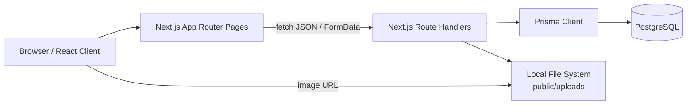
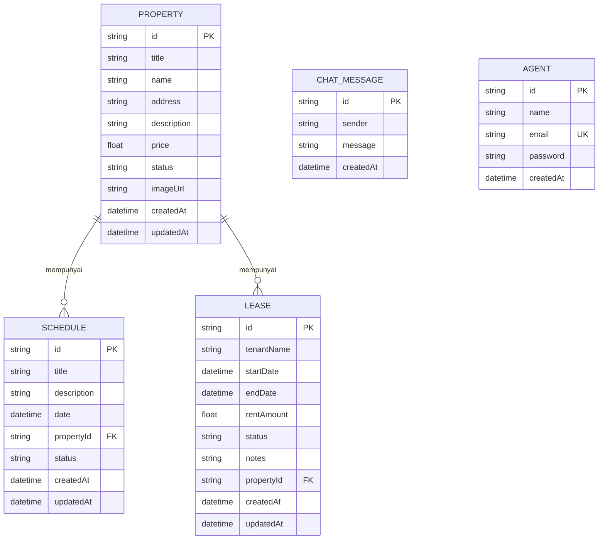

# Blueprint Arsitektur - PT Duta Properti

Dokumen ini mendeskripsikan arsitektur **sesuai implementasi saat ini** serta arsitektur target untuk pengembangan lanjutan. Nama proyek: `duta-properti`, Next.js App Router full-stack.

## 1. Ringkasan Produk

PT Duta Properti adalah aplikasi manajemen properti komersial yang mencakup:

- Autentikasi dan portal agen
- Dashboard operasional
- Manajemen unit properti
- Katalog properti publik
- Monitoring kontrak sewa
- Penjadwalan internal dan survei
- Chatbot asisten berbasis respons terstruktur
- Upload foto properti ke penyimpanan lokal

## 2. Stack Teknologi

| Lapisan | Teknologi | Penggunaan |
|---|---|---|
| Framework | Next.js 16.4.5 App Router | Routing, UI, Server API, rendering |
| Bahasa | TypeScript 5 | Type safety frontend dan backend |
| UI | React 19.3, Tailwind CSS 4 | Komponen interaktif dan styling |
| Backend | Next.js Route Handlers | REST-style endpoints di `/app/api` |
| ORM | Prisma 5.19 | Query PostgreSQL dan migrasi schema |
| Database | PostgreSQL | Penyimpanan data relasional |
| Font | Geist dan Geist Mono via `next/font` | Tipografi antarmuka |
| Penyimpanan file | Local filesystem `/public/uploads` | Foto properti |
| AI dependencies | `@google/generative-ai` | Dependency tersedia, tetapi belum digunakan secara aktif oleh route chat |

## 3. Struktur Repository

```text
app/
  api/
    auth/login/route.ts
    auth/register/route.ts
    catalog/route.ts
    chat/route.ts
    dashboard/route.ts
    leases/route.ts
    properties/route.ts
    property/route.ts
    schedules/route.ts
  catalog/page.tsx
  chat/page.tsx
  dashboard/page.tsx
  leases/page.tsx
  login/page.tsx
  properties/page.tsx
  property/page.tsx
  schedules/page.tsx
  globals.css
  layout.tsx
  page.tsx
lib/prisma.ts
prisma/schema.prisma
prisma/migrations/
public/uploads/
```

## 4. Arsitektur Sistem



Tidak ada lapisan service terpisah; halaman client memanggil Route Handler melalui `fetch`, Route Handler melakukan validasi, proses bisnis sederhana, dan query Prisma.

## 5. Backend Architecture

### 5.1 Prisma Singleton

[lib/prisma.ts](lib/prisma.ts) membuat satu instance `PrismaClient`. Instance global dipakai ulang pada development untuk menghindari terlalu banyak koneksi akibat hot reload.

### 5.2 Route Catalog

| Method | Endpoint | Fungsi |
|---|---|---|
| GET | `/api/catalog?search=` | Menampilkan properti berstatus `AVAILABLE`, dengan pencarian nama/alamat |
| GET/POST | `/api/properties` | Membaca atau membuat properti menggunakan JSON |
| DELETE | `/api/properties?id=` | Menghapus properti |
| GET/POST | `/api/property` | Membaca properti atau membuat properti beserta foto melalui `FormData` |
| GET | `/api/dashboard` | Menghasilkan metrics, jadwal terdekat, dan lease perhatian |
| GET/POST | `/api/leases` | Membaca/menghitung status lease dan membuat kontrak baru |
| GET/POST | `/api/schedules` | Membaca atau membuat jadwal |
| GET/POST | `/api/chat` | Membaca riwayat atau menyimpan pesan user dan respons bot |
| POST | `/api/auth/register` | Membuat akun agent |
| POST | `/api/auth/login` | Memvalidasi kredensial agent |

### 5.3 Contract API

Respons sukses umumnya mengikuti pola:

```json
{
  "success": true,
  "data": [],
  "message": "Pesan opsional"
}
```

Respons gagal mengikuti pola:

```json
{
  "success": false,
  "error": "Pesan kesalahan"
}
```

HTTP status utama:

- `200`: request berhasil
- `201`: data berhasil dibuat
- `400`: data atau parameter tidak valid
- `401`: autentikasi gagal
- `500`: kegagalan server/database

### 5.4 Validasi dan Bisnis Logic

- Pencarian catalog menggunakan `contains` + `mode: insensitive`.
- Harga properti dikonversi ke `Float`.
- Kontrak lease menghitung status dari tanggal akhir:
  - `EXPIRED`: `< 0` hari
  - `EXPIRING_SOON`: `0-30` hari
  - `ACTIVE`: `> 30` hari
- Upload foto menyimpan file fisik dengan nama berbasis timestamp.
- Jadwal dapat terhubung ke properti secara opsional.
- Chat menggunakan pencocokan kata kunci sederhana untuk `sewa`, `jadwal`, dan `properti`.

## 6. Data Model



### Relasi

- `Property -> Schedule`: one-to-many, penghapusan properti mengubah `propertyId` schedule menjadi `null`.
- `Property -> Lease`: one-to-many, penghapusan properti menghapus lease terkait.
- `ChatMessage` dan `Agent` tidak memiliki relasi di schema saat ini.

## 7. Frontend Architecture

Semua halaman utama adalah Client Components (`'use client`) karena menggunakan state, form, dan `fetch`.

### 7.1 Peta Halaman

| Route | Fungsi | Sumber data |
|---|---|---|
| `/login` | Login dan registrasi agent | `/api/auth/*` |
| `/dashboard` | Metrics, monitoring, jadwal, dan quick property management | `/api/dashboard`, `/api/property` |
| `/properties` | Versi manajemen properti menggunakan tabel dan JSON | `/api/properties` |
| `/property` | Versi manajemen properti dengan upload foto | `/api/properties` |
| `/catalog` | Katalog publik dengan pencarian | `/api/catalog` |
| `/leases` | Form dan tabel kontrak sewa | `/api/leases`, `/api/properties` |
| `/schedules` | Form dan tabel agenda | `/api/schedules`, `/api/properties` |
| `/chat` | Riwayat dan interaksi chatbot | `/api/chat` |

`/dashboard`, `/properties`, dan `/property` mengandung implementasi manajemen properti yang tumpang tindih. Mereka harus dikonsolidasikan ke satu rute target agar tidak membingungkan sumber kebenaran.

### 7.2 State Management

State lokal menggunakan React `useState`, efek awal menggunakan `useEffect`, dan mutasi dilakukan melalui `fetch` + refresh state. Belum ada Redux, Zustand, React Query, context, atau cache server khusus.

### 7.3 Navigasi

Navigasi utama menggunakan `next/link` dan `next/navigation`. Redirect login menggunakan `router.push('/dashboard')`.

## 8. User Interface dan Typography

### 8.1 Fondasi Tipografi

Root layout memuat:

- `Geist`: font sans untuk seluruh antarmuka
- `Geist_Mono`: font monospace untuk kode atau konten teknis
- Bahasa halaman: `en`
- Antialias: `antialiased`

Catatan: stylesheet global saat ini mengatur `body` memakai `Arial, Helvetica, sans-serif`, sehingga variabel font Geist pada root belum sepenuhnya menjadi default body.

### 8.2 Skala Visual Saat Ini

| Peran | Ukuran umum | Style |
|---|---|---|
| Judul halaman | `text-3xl` | bold / extrabold |
| Judul section | `text-xl` | semibold / bold |
| Judul card | `text-lg` | semibold / bold |
| Label form | `text-sm` atau `text-xs` | medium / semibold |
| Badan teks | `text-sm` atau `text-base` | regular / medium |
| Metadata | `text-xs` atau `text-[11px]` | regular |

### 8.3 Hierarki Target

```css
:root {
  --font-sans: var(--font-geist-sans);
  --font-mono: var(--font-geist-mono);
}

body {
  font-family: var(--font-sans), Arial, Helvetica, sans-serif;
}
```

Skala rekomendasi:

| Token | Ukuran | Baris |
|---|---:|---:|
| Display | 36px | 44px |
| H1 | 30px | 36px |
| H2 | 24px | 32px |
| H3 | 18px | 28px |
| Body | 16px | 24px |
| Small | 14px | 20px |
| Caption | 12px | 16px |

Gaya tipografi resmi:

- Bahasa UI utama: Bahasa Indonesia
- Heading: berat 600-700
- Label: berat 600, huruf jarak kecil untuk uppercase jika diperlukan
- Angka dan tabel: tabular numerals
- Mata uang: format `id-ID`, misalnya `Rp 75.000.000`
- Tanggal: format Indonesia, misalnya `24 November 2026`

### 8.4 Tema Warna

- Primary: blue `#2563EB`
- Success / available: emerald atau green
- Warning / expiring soon: orange atau amber
- Danger / expired: red
- Neutral surface: white, gray, dan slate
- Background: `#F9FAFB` / `#F8FAFC`

Gunakan status sebagai kombinasi warna dan teks, bukan warna saja.

### 8.5 Komponen UI

- Card: `rounded-xl` atau `rounded-2xl`, border tipis, shadow lembut
- Form: label jelas, border slate/gray, ring blue saat focus
- Button: primary blue, loading state, disabled state
- Badge: rounded-full, status berwarna
- Table: responsive dengan horizontal scroll
- Alert: success, error, dan empty state
- Katalog: card properti dengan image ratio tetap

## 9. Authentication dan Session Target

Implementasi saat ini:

- Register menyimpan nama, email, dan password.
- Login membandingkan password secara langsung.
- Login sukses mengarahkan ke dashboard di client.
- Belum ada cookie/session/JWT/server authorization.
- Belum ada middleware proteksi route.
- Belum ada role-based access control.
- Password disimpan sebagai teks biasa.

Arsitektur target:

- Gunakan `bcrypt` atau library password hashing.
- Gunakan HttpOnly cookie atau provider auth berdaftar.
- Tambahkan session yang tervalidasi server-side.
- Lindungi route `/dashboard`, `/leases`, `/schedules`, `/properties`, dan `/property`.
- Jangan mengembalikan password atau hash pada response.
- Tambahkan CSRF protection untuk mutasi state-changing.
- Definisikan peran `ADMIN`, `AGENT`, dan `TENANT`.

## 10. Data Flow

### 10.1 Login

```text
User -> Login Page -> POST /api/auth/login
     -> Prisma Agent.findUnique
     -> validasi password
     -> redirect /dashboard
```

### 10.2 Create Property

```text
User -> Form -> POST /api/property FormData
     -> validasi field
     -> simpan file ke public/uploads
     -> Prisma Property.create
     -> response properti baru
     -> refresh daftar dan dashboard
```

### 10.3 Create Lease

```text
User -> Lease Form -> POST /api/leases
     -> validasi data
     -> konversi tanggal dan harga
     -> Prisma Lease.create
     -> GET /api/leases menghitung status secara runtime
```

### 10.4 Chat

```text
User -> Chat Form -> POST /api/chat
     -> Prisma ChatMessage.create(sender=user)
     -> keyword matching
     -> Prisma ChatMessage.create(sender=bot)
     -> fetch riwayat terbaru
```

## 11. Security dan Reliability Gaps

Prioritas tinggi:

1. Hash password dan tambahkan session autentikasi.
2. Lindungi seluruh route internal.
3. Tambahkan authorization berdasarkan role.
4. Validasi schema request dengan Zod atau library setara.
5. Batasi ukuran, tipe, dan nama file upload.
6. Gunakan storage objek untuk deployment production.
7. Hindari `` mentah untuk optimisasi dan lint yang benar.
8. Tambahkan transaksi database untuk operasi bergantung.
9. Hilangkan `alert()` dan gunakan toast/dialog terintegrasi.
10. Tambahkan logging terstruktur dan error boundary.

Prioritas menengah:

- Pisahkan JSON property API dan FormData property API.
- Buat service layer: `services/property.ts`, `services/lease.ts`, dan seterusnya.
- Gunakan React Query/SWR untuk cache dan invalidasi.
- Tambahkan pagination untuk properti, lease, jadwal, dan chat.
- Tambahkan migrasi status dengan enum Prisma, bukan string bebas.
- Tambahkan email lowercase/normalisasi.
- Tambahkan unit dan integration tests.

## 12. Rencana Implementasi Bertahap

### Fase 1 - Stabilitas

- Konsolidasi dua route property menjadi satu API yang konsisten.
- Konsolidasi `/properties` dan `/property` menjadi satu halaman.
- Tambahkan loading, empty state, dan error state per modul.
- Tambahkan validasi backend yang seragam.

### Fase 2 - Authentication

- Tambahkan password hashing.
- Tambahkan session cookie.
- Tambahkan middleware route protection.
- Tambahkan role dan permission.

### Fase 3 - Domain Model

- Pisahkan status property, lease, dan schedule sebagai enum.
- Pindahkan kalkulasi lease ke domain helper.
- Tambahkan update dan delete untuk lease/schedule.
- Tambahkan audit timestamp dan audit actor.

### Fase 4 - Production Readiness

- Pindahkan upload ke cloud/object storage.
- Tambahkan database migration CI.
- Tambahkan automated tests.
- Tambahkan observability dan backup PostgreSQL.
- Tambahkan deployment pipeline dan environment validation.

## 13. Environment

Variabel lingkungan minimum:

```env
DATABASE_URL="postgresql://..."
```

Variabel target production:

```env
DATABASE_URL="postgresql://..."
AUTH_SECRET="..."
NEXT_PUBLIC_APP_URL="https://..."
UPLOAD_PROVIDER="s3"
UPLOAD_BUCKET="..."
GOOGLE_GENERATIVE_AI_API_KEY="..."
```

Tidak commit secret ke repository.

## 14. Quality Gates

Sebelum production:

- `npm run lint`
- `npm run build`
- `npx prisma migrate deploy`
- Unit tests untuk status lease
- Integration tests untuk auth dan mutasi property
- Upload tests untuk tipe, ukuran, dan nama file
- Responsive UI test pada mobile, tablet, dan desktop
- Accessibility check: label, contrast, focus state, keyboard navigation

## 15. As Built vs Target

| Area | Saat Ini | Target |
|---|---|---|
| Routing | App Router + Route Handler | Tetap |
| Database | PostgreSQL + Prisma | Tetap dengan enum dan migrasi konsisten |
| API | JSON/FormData ad hoc | Shared contract dan validasi Zod |
| Auth | Plain password + no session | Hashed password + secure session |
| Upload | Local `/public/uploads` | Object storage |
| Chat | Keyword-based response | LLM/RAG optional dengan guardrail |
| UI state | React local state | Shared server/cache state |
| Property pages | Tumpang tindih | Satu module management |
| Typography | Geist + mixed Arial/utility classes | Sistem typography token yang konsisten |
